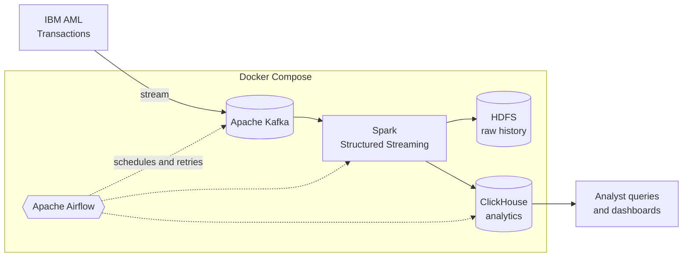

<!-- Banner -->

 

---

## 👋 About Me

<table>
<tr>
<td width="62%" valign="top">

I am a **Data Engineer** and **Big Data Engineer** focused on building reliable, containerized and cloud-based data pipelines for regulated, high-volume environments such as banking.

- 🎓 **Computers & AI (Information Systems)**, Cairo University, class of **2027**
- 🏦 **3 banking internships:** CIB (x2) and Agricultural Bank of Egypt
- 🛰️ Built a **5-technology streaming and batch platform** for anti-money-laundering analytics
- ☁️ Built **Azure pipelines** with Data Factory, Databricks and ADLS Gen2
- 🧱 Strong in **distributed systems, columnar storage and file formats** (Parquet, ORC, Avro)
- 🔎 Extract data from any source, including scanned documents with **OCR**
- 🤝 Lead small teams and document every pipeline so the next person can run it

</td>
<td width="38%" valign="top" align="center">

  
  
  

</td>
</tr>
</table>

---

## 🧠 Tech Stack

<table>
<tr>
<td><b>⚡ Big Data & Streaming</b></td>
<td>

</td>
</tr>
<tr>
<td><b>🔄 Orchestration & DevOps</b></td>
<td>

</td>
</tr>
<tr>
<td><b>🗄 Databases & Warehouses</b></td>
<td>

</td>
</tr>
<tr>
<td><b>☁️ Cloud (Azure)</b></td>
<td>

</td>
</tr>
<tr>
<td><b>🐍 Languages & Analytics</b></td>
<td>

</td>
</tr>
<tr>
<td><b>🧱 Storage & Concepts</b></td>
<td>

</td>
</tr>
</table>

---

## 🛰️ Featured Project: AML Transaction Analytics Platform

> **Scenario:** a bank must spot money-laundering patterns fast, while keeping a complete and auditable history of every transaction.

| | |
|---|---|
| 🧩 **Architecture** | Lambda-style: a streaming layer for fresh data and a batch layer for full history |
| 🐳 **Deployment** | 5 core technologies (8 containers), started with **one** Docker Compose command |
| 📥 **Ingestion** | 5M+ IBM AML transactions through Kafka into Spark, raw history archived in HDFS |
| ⚡ **Analytics** | ClickHouse tables with partitioning and sort keys, aggregations in about 1 second |
| 🛠 **Orchestration** | 6 pipeline stages scheduled, retried and monitored with Airflow DAGs |

**Stack:** `Kafka` `Spark` `Airflow` `ClickHouse` `Hadoop/HDFS` `Docker Compose`

<!-- Add the repository link here: [View repository](https://github.com/Mohamed-sa3d200/REPO-NAME) -->

---

## 🧪 More Projects

<table>
<tr>
<td width="50%" valign="top">

### ☁️ Azure Lakehouse Pipeline
Ingests 4 sources (SQL, CSV, Excel, REST API) with **Data Factory** into a **bronze → silver → gold** layout on **ADLS Gen2**, converts raw CSV to partitioned **Parquet** in **Databricks** (about 70% smaller), validates row counts and nulls between layers, and serves **Power BI** daily.

`Azure Data Factory` `Databricks` `ADLS Gen2` `Parquet` `Power BI`

</td>
<td width="50%" valign="top">

### 🔎 Document Data Extraction (OCR)
Extracts fields from 500+ scanned documents with **OCR** (about 90% field accuracy), loads validated records into **PostgreSQL**, and logs rejected rows for review.

`Python` `Tesseract OCR` `Pandas` `PostgreSQL`

</td>
</tr>
</table>

---

## 🏦 Experience & Training

| When | What | Where |
|:--|:--|:--|
| **2025 - 2026** | Data Analyst Trainee: financial data pipelines and reporting under data governance and compliance rules | 🏦 Commercial International Bank (CIB) |
| **2024** | Data Analyst Trainee: database management, validation and automated reporting cycles | 🌾 Agricultural Bank of Egypt |
| **Big Data Track** | Hadoop ecosystem, distributed storage, big data analysis | 🎓 Huawei x NTI |
| **2025** | Data Security Training | 🔐 NTI |

---

## 📜 Certifications

---

## 📊 GitHub Stats

 

---

## 🚀 Currently

- 🔭 Deepening **streaming reliability** (exactly-once delivery, late data, replay from HDFS)
- 🧪 Building **data quality gates** for regulated data
- 📈 Benchmarking **ClickHouse, PostgreSQL and Spark SQL** on large datasets
- 💼 Open to **Data Engineer** roles and internships

## 🤝 Let's Connect

**Have a data problem that has outgrown one machine? Let's talk.**

